# 3.1.10. Consolidação do planejamento e decisões de integração

O planejamento das seções 3.1.1 a 3.1.9 foi materializado em três componentes: transporte embarcado, infraestrutura Firebase e aplicativo Android. A implementação manteve a condução local da atividade e a comunicação assíncrona. Na integração com a etapa 2, foram acrescentados campos e funções para compatibilizar o contrato efetivamente utilizado pelo orquestrador. A tabela abaixo complementa as interfaces e estruturas previstas nas seções 3.1.2, 3.1.3 e 3.1.5.

| Elemento | Definição consolidada na implementação |
|---|---|
| Snapshot atual | `iot_update_status(const HidraStatusSnapshot&)` recebe o estado do orquestrador; o adapter o copia para o transporte. |
| Ordem das sessões | `activity_started.data.session_order` é um inteiro positivo persistido na NVS. O mesmo valor é utilizado em `summary/session_order`. Publicadores legados sem esse campo conservam a geração local. |
| Identidade de inicialização | O transporte recebe `hidra_boot_id()` da etapa 2. O contador utiliza os 32 bits, sem truncamento para 16 bits. |
| Estado entre atividades | `status.state` permanece E0–E5. `activity_active=false` distingue sistema ocioso de atividade em andamento, mesmo quando o último estado é E1. |
| Campos adicionais de presença | `sequence`, `attempt`, `active_alert_count`, `mass_available` e `mass_g` quando disponível e finita. Uma massa negativa no status é diagnóstico de tara; massa e volume nos eventos devem ser não negativos. |
| Recuperação | A inicialização reconcilia a referência NVS com a última sequência persistida da mesma sessão no diário IoT, antes de aceitar novas atividades. |
| Organização do firmware | O ambiente `esp32-integrated` compila o sketch e o hardware da etapa 2 com o transporte da etapa 3. O transporte interno está no namespace `HidraIoT`, evitando colisão entre estruturas homônimas. |

O snapshot de status continua separado do histórico: reenviar eventos antigos não significa que o usuário está repetindo a atividade. A publicação de presença ocorre a cada 30 segundos quando a comunicação permite; após 90 segundos sem presença recebida, o aplicativo identifica os dados como desatualizados. O recebimento no servidor e o instante de observação são informações distintas.

A estimativa de volume também foi delimitada pela montagem: a base possui uma microchave e não pesa o copo. A conclusão pela base não produz `estimated_intake_ml`; a estimativa depende do retorno do copo à plataforma de pesagem. A instrução `return_cup` permanece associada às faixas existentes. Uma nona faixa específica para devolução à balança depende de gravação e ampliação do limite de faixas, não tendo sido incluída nesta versão.

Os cenários e metas da seção 3.1.9 foram tratados como critérios de verificação. A seção 3.2.7 apresenta os resultados obtidos e a seção 3.2.8 delimita os ensaios ainda não realizados. A aprovação do software e da comunicação não foi utilizada como comprovação de ingestão, latência acústica ou funcionamento completo da montagem física.

---PAGE---

# 3.2. Implementação da etapa 3

Foi implementada a comunicação entre a ESP32, o Firebase Realtime Database e um aplicativo Android destinado ao cuidador. O firmware recebe eventos já interpretados pelo orquestrador, preserva registros pendentes e os publica via HTTPS. O aplicativo consulta dispositivos autorizados, presença, resumos e eventos de cada atividade. A versão examinada é a 0.2.0 do aplicativo, instalada no telefone e registrada nas capturas de tela de 15/11/2026.

A implementação está na pasta `HIDRA_Etapa3` do repositório HIDRA, branch `iot_firebase_mobile`. O firmware unificado reutiliza `HIDRA_Etapa2` como biblioteca local, sem duplicar a máquina de estados na etapa 3. A revisão de software corresponde ao commit `6573a7d`; a documentação da main incorporada antes desta redação corresponde ao commit `b5fd031`.

## 3.2.1. Organização do software e ambiente de desenvolvimento

| Diretório ou arquivo | Implementação |
|---|---|
| `firmware/iot/include/iot.h` | Estruturas de tamanho limitado e API interna do transporte. |
| `firmware/iot/src/iot.cpp` | Fila FreeRTOS, diário LittleFS, autenticação, HTTPS, presença e sincronização. |
| `firmware/iot/src/orchestrator_adapter.cpp` | Conversão do contrato canônico da etapa 2 para o transporte. |
| `firmware/iot/src/integrated_main.cpp` | Inclusão do sketch real da etapa 2 no firmware único. |
| `firebase/` | Regras de acesso e validação, índices e emuladores Auth/RTDB. |
| `simulator/` | Contrato Python, cenários, diário SQLite e cliente REST. |
| `android/app/src/main/` | Aplicativo Kotlin/Compose, repositórios, ViewModel, telas e apresentação. |
| `tests/` e `scripts/` | Testes de contrato, ponte C++, regras, REST e automação de compilação. |

O ambiente embarcado foi fixado em PlatformIO 6.2.0, Espressif32 6.10.0, Arduino ESP32 2.0.17, C++17, ArduinoJson 7.3.0 e HX711 0.7.5. Essa combinação compilou o hardware e o orquestrador da etapa 2 junto ao transporte real. A compilação Arduino IDE da etapa 2, com core 3.3.x e stub serial, permanece como ambiente distinto de diagnóstico.

No computador foram utilizados Python 3.10, G++ com C++17, Node.js 22.16.0, Firebase CLI 15.34.2 e JDK 21. O aplicativo utiliza Kotlin, Jetpack Compose e Material 3, Gradle Wrapper 8.9, SDK Android 35 e Build Tools 34.0.0, com alvo Java/Kotlin 17 e Android mínimo API 26. Os APKs foram compilados com o JDK 21 disponível na máquina.

```ini
[env:esp32-integrated]
extends = env:esp32dev
board_build.partitions = default.csv
build_flags = ${env:esp32dev.build_flags} -DHIDRA_INTEGRATED_ORCHESTRATOR -DHIDRA_IOT_STUB=0
lib_deps =
    ${env:esp32dev.lib_deps}
    symlink://../../HIDRA_Etapa2
```

Listagem 3.2-1 — Ambiente de integração, extraído de `firmware/platformio.ini`. A tabela de partições corresponde a Default 4MB with spiffs; o sistema de arquivos utilizado é LittleFS.

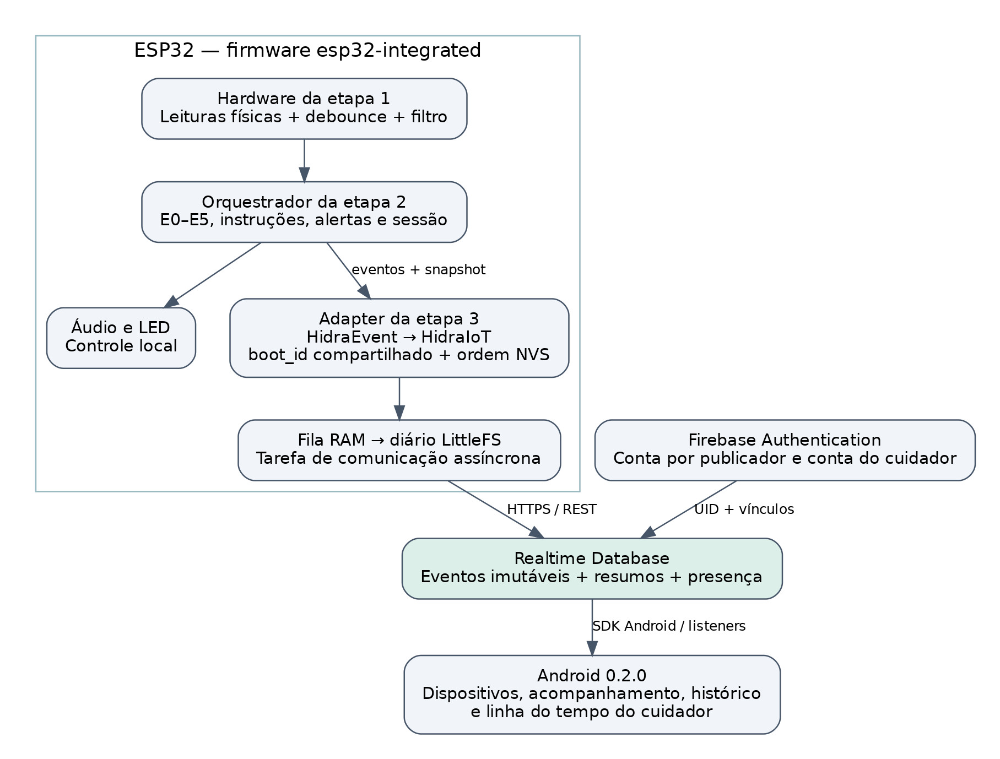

O projeto gera quatro ambientes de firmware: `esp32dev`, `esp32-synthetic`, `esp32-network-probe` e `esp32-integrated`. O sintético permite verificar o transporte sem sensores; o diagnóstico verifica rede, UTC e TLS. O ambiente utilizado na integração das três etapas é `esp32-integrated`.

## 3.2.2. Contrato de eventos e simulador Python

O contrato remoto utiliza `schema_version=1`, identificação do dispositivo e da sessão, sequência positiva, tipo, estado E0–E5, identidade do boot e tempo monotônico. O horário UTC de ocorrência é omitido quando ainda não está sincronizado. Os indicadores `has_*` do produtor determinam quais campos opcionais são serializados; campos ausentes não são substituídos por valores artificiais.

| Tipo de evento | Dados específicos |
|---|---|
| `activity_started` | `trigger` e, no firmware integrado, `session_order`. |
| `state_changed` | `previous_state`; `mass_g` opcional. |
| `instruction_played` | `instruction_id` e `attempt`. |
| `caregiver_alert` | `alert_id`, `reason` e `attempt`. |
| `alert_resolved` | `alert_id` e `reason`, associados ao alerta original. |
| `activity_completed` | `estimated_intake_ml` opcional, somente quando estimado. |
| `activity_aborted` | Motivo `restart` ou `local_cancel`. |

Os identificadores têm de 1 a 63 caracteres ASCII alfanuméricos, hífen ou sublinhado. O firmware limita o JSON de evento a 1024 bytes. Massa e volume de eventos precisam ser finitos e não negativos. A validação Python e as regras RTDB aplicam o mesmo esquema de campos permitidos; o documento `docs/CONTRATO.md` registra os caminhos e os tipos aceitos.

O simulador possui três cenários independentes: `normal`, com sete eventos; `alert`, com dez eventos e resolução explícita do alerta; e `interrupted`, com cinco eventos e interrupção local. Esses cenários são testes do contrato e do transporte. Não reproduzem leituras de sensores nem substituem o orquestrador da etapa 2. O diário SQLite utiliza checksum SHA-256 e conserva dados necessários ao reenvio e à reconstrução dos resumos.

```bash
# A partir de HIDRA_Etapa3/
python3 -m simulator --scenario normal
python3 -m simulator --scenario alert --output .runtime/alert.json
python3 -m simulator --scenario interrupted --output .runtime/interrupted.json
python3 -m unittest tests.test_simulator -v
```

Listagem 3.2-2 — Comandos de geração dos cenários e de reprodução dos 14 testes do contrato/diário. O diretório `.runtime` reúne os arquivos locais de execução e é ignorado pelo Git.

A verificação de compatibilidade com a etapa 2 foi feita separadamente: o teste `test_orchestrator_bridge.py` compila o orquestrador e o adapter reais, aplica entradas físicas controladas e valida os eventos produzidos. Foram cobertos ciclo com retorno à balança e estimativa de 150 mL, conclusão pela microchave sem volume, alerta/resolução e reinício com continuação da sequência. O valor de 150 mL pertence ao cenário de teste e não constitui medição no usuário.

## 3.2.3. Módulo IoT no ESP32

### 3.2.3.1. Interface e separação de responsabilidades

O contrato canônico recebido do orquestrador está em `HIDRA_Etapa2/src/contrato/HidraEvent.h` e `src/iot/HidraIot.h`. A etapa 2 determina sessão, sequência, transições, instruções e alertas. O adapter converte esses dados para as estruturas do transporte. O módulo IoT acrescenta a identificação remota do evento e os tempos disponíveis, sem decidir o próximo estado da atividade.

```cpp
bool iot_publish(const HidraEvent& event) {
    if(!ready || !valid(event)) { error(-1); return false; }
    Queued q{}; q.event=event; q.uptime=monotonicMs();
    q.occurred=utcValid()?static_cast<int64_t>(time(nullptr))*1000:-1;
    portENTER_CRITICAL(&mux); q.counter=++counter; portEXIT_CRITICAL(&mux);
    if(xQueueSend(queue,&q,0)!=pdTRUE) { loss(); return false; }
    return true;
}
```

Listagem 3.2-3 — Função real de entrada do transporte em `iot.cpp`. A cópia é feita para uma fila de 32 posições, sem espera por rede ou gravação em Flash nessa chamada. Retorno positivo indica somente aceitação em RAM; a etapa 2 registra recusas sem bloquear o controle local.

A tarefa `hidra_iot` transfere os registros para um diário LittleFS de até 200 eventos. Cada registro contém tamanho e CRC32; a ordem persistente do diário permite reenviar eventos entre boots mesmo sem UTC. O worker executa autenticação e requisições HTTPS em uma tarefa separada, com stack de 16 KiB. Existe uma janela de perda entre a aceitação em RAM e a gravação no diário.

### 3.2.3.2. Adapter, identidade e snapshot

```cpp
void iot_begin(const IotConfig& config) {
    HidraIoT::IotConfig transport{config.device_id,config.wifi_ssid,config.wifi_password,
        config.database_url,config.api_key,config.device_email,config.device_password,
        HIDRA_GOOGLE_ROOTS,hidra_boot_id()};
    HidraIoT::iot_begin(transport);
}
```

Listagem 3.2-4 — Inicialização no adapter. `hidra_boot_id()` fornece ao transporte a mesma identidade usada pela etapa 2, enquanto a cadeia de certificados públicos valida os endpoints HTTPS.

O adapter mapeia explicitamente os sete tipos de evento, valida os limites dos textos e preserva `has_mass_g`, `has_estimated_intake_ml` e `has_session_order`. O uso de `namespace HidraIoT` permite manter a interface global da etapa 2 sem conflito de tipos. O `session_order` NVS é elevado ao piso recuperado do transporte durante a inicialização, evitando repetir os ordinais já utilizados pelo firmware de ensaio.

```cpp
    converted.has_details=true; converted.activity_active=value.activity_active;
    converted.sequence=value.sequence; converted.attempt=value.attempt;
    converted.active_alert_count=value.active_alerts;
    converted.mass_available=value.mass_available;
    converted.mass_g=value.mass_g;
    HidraIoT::iot_set_snapshot(converted);
```

Listagem 3.2-5 — Trecho de `iot_update_status`, em `orchestrator_adapter.cpp`. O snapshot informa se há uma atividade ativa, independentemente do último estado E0–E5. O transporte guarda a cópia sob seção crítica e a publica pelo fluxo de presença.

Na recuperação, o sketch consulta NVS e diário, escolhe a última sequência persistida da mesma sessão e solicita o encerramento por reinício ao orquestrador. A montagem integrada usa `LittleFS.begin(false)`, sem formatação automática. Uma imagem de filesystem não deve ser gravada sobre o diário existente; a preparação inicial da partição foi realizada separadamente.

### 3.2.3.3. Compilação e diagnóstico executados

```bash
# A partir de HIDRA_Etapa3/
pio run -d firmware -e esp32-integrated
pio run -d firmware -e esp32-integrated -t upload --upload-port /dev/ttyACM0
pio device monitor -p /dev/ttyACM0 -b 115200
```

Listagem 3.2-6 — Compilação, gravação e monitoramento da placa utilizada. A porta é específica da máquina de ensaio. O console utiliza final de linha Nova linha; `s` consulta estado e conexão, `iniciar` abre uma atividade e `cancelar` a encerra localmente. Os comandos atuam no orquestrador real, sem criar medições físicas fictícias.

A placa identificada foi uma ESP32-D0WD-V3, revisão 3.1, com Flash de 4 MiB. Antes da gravação foi preservado um backup completo da Flash. Credenciais ficam em `firmware/iot/include/secrets.h`, fora do versionamento; a listagem não contém valores de rede ou senhas.

## 3.2.4. Configuração do Firebase e controle de acesso

O projeto remoto utilizado foi `hidra-743c9`, com Realtime Database em `https://hidra-743c9-default-rtdb.firebaseio.com`. Foram cadastradas contas por e-mail/senha para o publicador da ESP32, o simulador e o cuidador. A arquitetura foi mantida compatível com o plano gratuito Spark, sem dependência de Cloud Functions ou serviços que exijam migração para Blaze. Operação contínua e retenção dos registros permanecem sujeitas aos limites do plano.

```text
caregiverDevices/{caregiver_uid}/{device_id} = true
deviceOwners/{device_id} = device_uid
devices/{device_id}/metadata
devices/{device_id}/status
devices/{device_id}/sessions/{session_id}/summary
devices/{device_id}/sessions/{session_id}/events/{event_id}/payload
devices/{device_id}/sessions/{session_id}/events/{event_id}/received_at_ms
```

Listagem 3.2-7 — Estrutura implantada no RTDB. Os vínculos são provisionados administrativamente; não são criados pelo aplicativo nem enviados pelo publicador como permissões de acesso.

O nó `metadata` identifica o equipamento e a origem dos dados. Durante os ensaios comandados pela Serial, `hidra_01` permaneceu marcado como `source=simulator`. Essa marca impede interpretar as sessões de bancada e os ciclos sintéticos como uso real por um paciente. O simulador desktop publica sob a identidade separada `sim_hidra_01`.

As regras negam leitura e escrita na raiz. O cuidador consulta somente seus vínculos e os dispositivos associados; não publica eventos nem modifica o status. O publicador só escreve nos filhos autorizados do seu próprio dispositivo. A leitura permitida para um equipamento não concede permissão de listar globalmente todos os equipamentos.

```json
{
  ".read": false,
  ".write": false,
  "caregiverDevices": {
    "$uid": { ".read": "auth != null && auth.uid == $uid" }
  }
}
```

Listagem 3.2-8 — Recorte inicial das regras implantadas. A permissão de leitura individual dos dispositivos também verifica o UID proprietário ou o vínculo do cuidador; o recorte não substitui o arquivo completo `firebase/database.rules.json`.

O arquivo completo restringe schema, tipos, estados, campos por evento e identificadores. Eventos existentes não podem ser alterados ou excluídos pelos clientes. O resumo não aceita regressão de `last_sequence` nem alteração de `session_order`. Índices em `summary/session_order` e `payload/sequence` atendem, respectivamente, à paginação do histórico e à ordem dos eventos.

No firmware são utilizados tokens de autenticação obtidos por HTTPS, renovados quando necessário. Não há credencial administrativa embarcada. No Android, o Firebase SDK utiliza a conta do cuidador e as mesmas regras de autorização. Chave de identificação do projeto, URL e configuração do aplicativo não substituem a autenticação. Senhas, tokens e configurações privadas não foram incluídos neste relatório nem no Git.

## 3.2.5. Envio, persistência e sincronização

### 3.2.5.1. Publicação idempotente

O caminho estável do evento é composto por dispositivo, sessão e `event_id`. Antes da gravação, o publicador consulta esse caminho com ETag. Se vazio, cria o registro por PUT condicional e inclui `received_at_ms` calculado pelo servidor. Se o registro já existe e o payload é idêntico, reconhece a confirmação anterior. Um payload diferente para o mesmo identificador é tratado como colisão de integridade, sem substituição cega.

```cpp
    if(!stored.isNull()) {
        if(stored["payload"].as<JsonVariantConst>() != event.as<JsonVariantConst>()) return -13;
    } else {
        JsonDocument record;
        record["payload"]=event.as<JsonVariantConst>();
        record["received_at_ms"][".sv"]="timestamp";
        code=database(path,"PUT",&record,response,nullptr,etag);
        if(code!=200) return code;
    }
```

Listagem 3.2-9 — Recorte de `publish`, em `iot.cpp`. A ETag obtida no GET é encaminhada como condição do PUT. O timestamp de recebimento do primeiro registro é preservado no reenvio.

Após confirmar o evento, o worker prepara e salva o resumo cumulativo local antes de publicá-lo remotamente. O resumo conserva a última sequência processada; reapresentar a mesma sequência não incrementa novamente contagens de instruções e alertas. Só depois da confirmação do resumo a pendência local é removida.

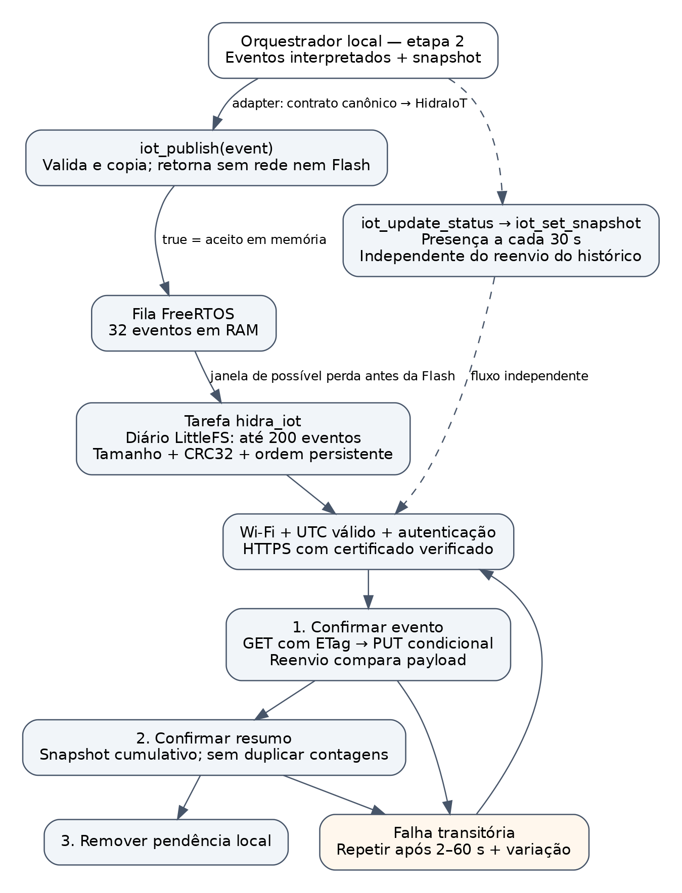

Falhas transitórias mantêm a pendência e provocam novas tentativas com espera de 2 a 60 segundos, acrescida de variação aleatória. Registros recusados por formato/autorização ou por integridade podem ser isolados para diagnóstico, marcando incompletude; a política não oferece entrega ilimitada diante de saturação ou perda de energia.

### 3.2.5.2. Presença e consistência após reinício

A presença utiliza o snapshot atual do orquestrador, e não o último evento histórico reenviado. Um status `activity_active=false`, `state=E1` e sessão interrompida é consistente: significa que a atividade foi encerrada e o último estado observado foi E1. Não implica que o usuário ainda esteja executando uma etapa.

O ensaio real mostrou inicialmente falhas de conexão HTTPS anteriores à autenticação. Os quatro eventos da sessão `0002_s001` permaneceram no diário. Após reiniciar a placa, ocorreu autenticação e drenagem das pendências; o cuidador leu o mesmo histórico. Isso comprova o caso observado de reconexão com registros persistidos, sem medir uma probabilidade de perda para todos os cortes possíveis de energia.

O segundo ensaio abriu `0004_s001`, com ordinal 4 e três eventos no boot `0004`. Após reinício controlado, a etapa 2 emitiu `activity_aborted` com sequência 4 e motivo `restart`, agora no boot `0005`. A sessão manteve seu identificador original; o identificador do evento de interrupção refletiu o novo boot. Como a interrupção foi produzida antes da sincronização UTC, seu horário de ocorrência não foi inventado.

```text
EVT ...;0004;4556;0004_s001;1;activity_started;E0;{"trigger":"button","session_order":4}
EVT ...;0004;4600;0004_s001;2;instruction_played;E0;{"instruction_id":"start","attempt":1}
EVT ...;0004;4858;0004_s001;3;state_changed;E1;{"previous_state":"E0"}
EVT sem-relogio;0005;669;0004_s001;4;activity_aborted;E1;{"reason":"restart"}
```

Listagem 3.2-10 — Recorte do log Serial real. O marcador `...` substitui apenas a coluna de data/hora já sincronizada para abreviar a listagem; os boots, uptimes, identificadores e dados são os do ensaio.

## 3.2.6. Aplicativo Android

### 3.2.6.1. Estrutura e acesso aos dados

O aplicativo foi implementado em Kotlin com Jetpack Compose e organização por repositórios e ViewModel. `AuthRepository` representa o acesso; `HidraRepository` expõe dispositivos, presença, resumo, histórico e eventos. `FirebaseHidraRepository` atende aos modos nuvem e emulador, enquanto `FakeHidraRepository` atende à demonstração independente. `HidraViewModel` organiza `UiState`, carregamento, erro, navegação e cancelamento dos listeners.

A aplicação possui três variantes: `demoDebug`, com dados fictícios; `emulatorDebug`, com Auth/RTDB locais; e `cloudDebug`, configurada para o projeto real. A versão 0.2.0 possui `versionCode=2`, applicationId `br.usp.hidra` na variante cloud e foi instalada como atualização no telefone do responsável. Os prints desta seção são capturas reais do aparelho, sem substituição do conteúdo exibido.

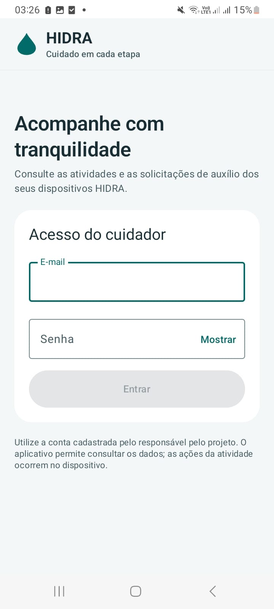
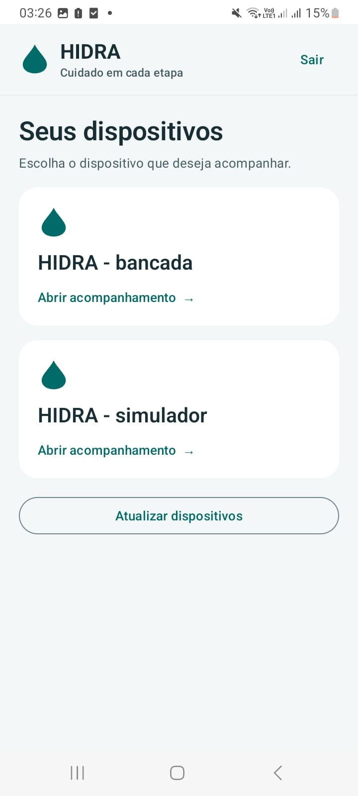

### 3.2.6.2. Acompanhamento, navegação e desatualização

A tela de acompanhamento apresenta o nome do equipamento, comunicação recente ou desatualizada, estado da atividade, última comunicação, resumo da última sessão e alertas ativos informados. O estado ocioso é exibido como sistema em repouso. As cores, cartões e hierarquia de texto distinguem dados de presença, resultado e ações de navegação; a interface oferece temas claro/escuro e respeita as áreas do sistema e do teclado.

```kotlin
val stale=status.lastSeenMs==null || s.now-status.lastSeenMs>90000
```

Listagem 3.2-11 — Critério utilizado em `HidraScreens.kt` para comunicação desatualizada. O relógio da interface é atualizado pelo ViewModel. A falta de internet do telefone é acompanhada separadamente por `ConnectivityManager.NetworkCallback`, inscrito somente enquanto seu fluxo é coletado no ciclo de vida da tela.

Nas capturas, a bancada continuava publicando presença e aparecia em repouso, com a sessão `0004_s001` interrompida. O simulador, que havia encerrado o ensaio anterior, aparecia sem comunicação recente. O aplicativo conservava seus dados históricos e explicava que o estado e os alertas poderiam ter mudado; não interpretava ausência de presença como novo alerta da atividade.

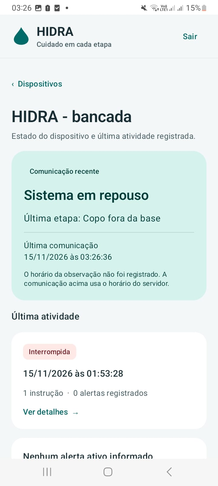
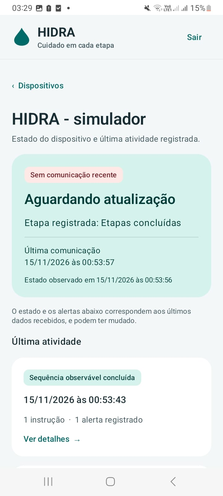

O cuidador consegue voltar à seleção de equipamentos sem encerrar sua conta, consultar histórico e retornar ao acompanhamento. A revisão também corrigiu um caso de erro: após login bem-sucedido, uma falha ao consultar os dispositivos agora mantém a tela correspondente e permite repetir a consulta. Os listeners são cancelados ao trocar de contexto ou sair do aplicativo e recriados quando a tela volta a ficar ativa.

### 3.2.6.3. Histórico e linha do tempo

O histórico consulta 20 sessões por página, ordenadas de forma decrescente por `session_order`. A tela mostra resultado, início, quantidade de instruções e alertas, sem confundir total histórico de alertas com alertas ainda ativos. Os detalhes ordenam eventos por `sequence` e traduzem motivos e instruções para descrições em português. Os campos do contrato permanecem acessíveis em dados técnicos recolhidos.

```kotlin
p.text("state").orEmpty(), p.number("occurred_at_ms"),
p.child("data").value?.toString().orEmpty(),
p.child("data").children.associate { field ->
    field.key.orEmpty() to field.value
}, it.number("received_at_ms")
```

Listagem 3.2-12 — Recorte do mapeamento de eventos em `Repositories.kt`. O objeto de apresentação conserva dados estruturados e o instante de recebimento, além da representação técnica original.

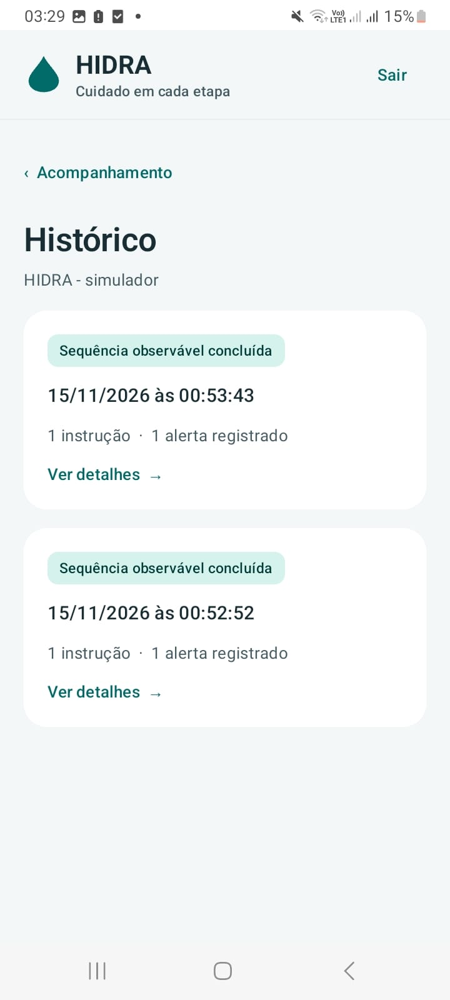
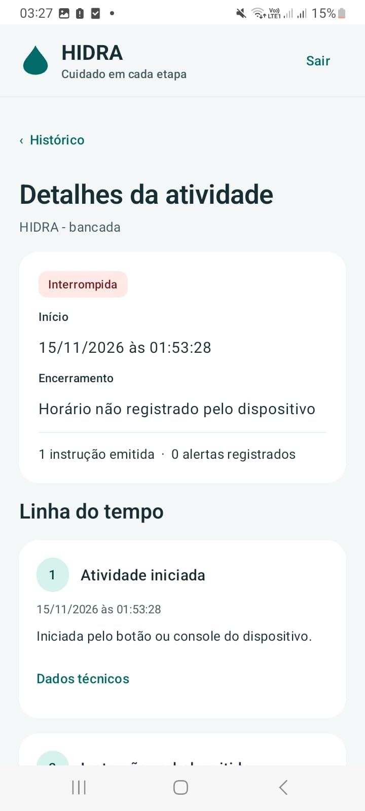

Quando `occurred_at_ms` não existe, a apresentação não substitui silenciosamente o horário do evento pelo do servidor. A interface informa “Recebido em” e identifica que o horário do evento não estava sincronizado. O resumo da atividade pode continuar sem horário de encerramento, pois esse campo representa a ocorrência, não o recebimento. O comportamento foi observado no registro de reinício da ESP32.

```kotlin
fun ActivityEvent.timeLabel(): String = when {
    occurredAtMs != null -> formatDate(occurredAtMs)
    receivedAtMs != null -> "Recebido em ${formatDate(receivedAtMs)}" +
        " · horário do evento não sincronizado"
    else -> "Horário do evento não registrado; a ordem foi preservada."
}
```

Listagem 3.2-13 — Função de apresentação de horário em `Presentation.kt`. Os valores armazenados no Firebase não são alterados pela interface.

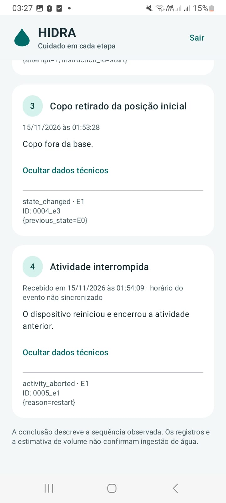
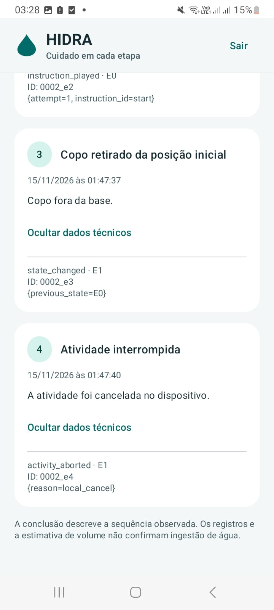

As capturas do simulador mostram o evento `caregiver_alert` seguido de `alert_resolved`, com a mesma referência de alerta. Por isso, o total de um alerta no resumo é compatível com a ausência de alertas ativos após resolução. Essas telas comprovam consulta do histórico já gravado; não demonstram, por si só, um alerta novo aparecendo em tempo real durante a captura.

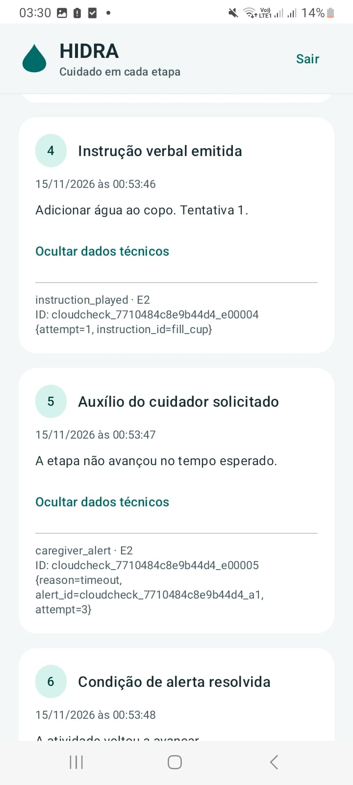
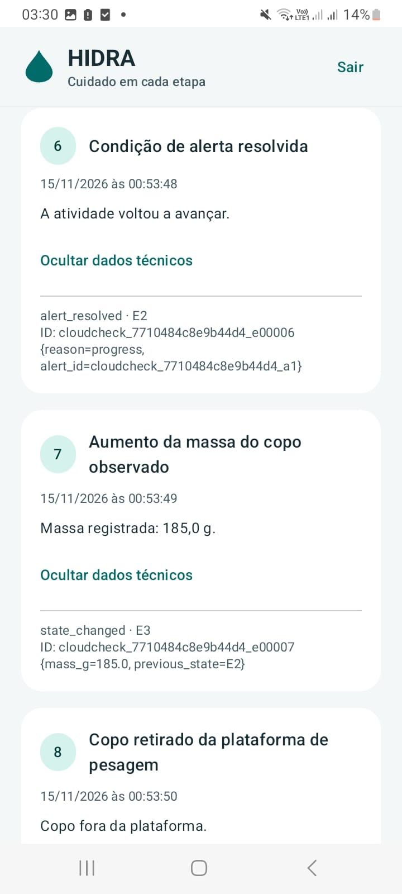

O aplicativo é de consulta: não altera estados do equipamento, resolve alertas remotamente ou aciona áudio. A resolução registrada decorre dos eventos do publicador. Os alertas são acompanhados com o aplicativo aberto, sem notificações push em segundo plano. A estimativa de volume, quando existente, não é apresentada como confirmação de ingestão.

## 3.2.7. Testes realizados e resultados

### 3.2.7.1. Ensaios automatizados e compilação

| Camada | Resultado observado | Alcance da verificação |
|---|---|---|
| Contrato e diário SQLite | 14 testes aprovados | Validação, ordenação, reenvio e persistência desktop. |
| Demonstração embarcada em C++ | 5 testes aprovados | `main.cpp` real com transporte substituído; bloqueio e repetição após recusa. |
| Ponte com a etapa 2 | 4 testes aprovados | Orquestrador e adapter reais; massa/volume, alerta, reinício e base sem volume. |
| Regras RTDB | 9 testes aprovados | Autorização, imutabilidade, campos válidos/inválidos, ordem e snapshot. |
| Auth/RTDB REST em emuladores | 5 testes aprovados | Autenticação, presença, envio/reenvio e eventos do orquestrador real. |
| Android ViewModel | 6 testes aprovados | Sessão atual, histórico, retorno, logout, falha recuperável e troca de dispositivo. |
| Apresentação Android | 5 testes aprovados | Reinício, horário de recebimento, motivos, unidades e ausência de volume. |
| Análise Android lint | Sem erros | Verificação estática; não substitui ensaio em aparelho. |
| Compilação de APK | 3 variantes compiladas | `demoDebug`, `emulatorDebug` e `cloudDebug`. |
| Compilação ESP32 | 4 ambientes compilados | Incluindo `esp32-integrated` com hardware/orquestrador reais. |

A suíte da etapa 3 totaliza 48 testes automatizados aprovados: 37 de contrato, demonstração, ponte, regras e REST, acrescidos de 11 testes JVM do Android. O total não inclui como testes adicionais as compilações, lint ou os ensaios manuais. A suíte da etapa 2 também foi executada: 73 assertivas em 14 cenários e teste de fumaça do firmware em duas fases, todos aprovados.

```bash
# Na raiz do repositório:
CCACHE_DISABLE=1 bash tests/run_tests.sh

# Em HIDRA_Etapa3/, com dependências instaladas:
bash scripts/test_all.sh
bash scripts/build_android.sh :app:testDemoDebugUnitTest :app:lintDemoDebug
pio run -d firmware -e esp32dev -e esp32-synthetic -e esp32-network-probe -e esp32-integrated
```

Listagem 3.2-14 — Comandos utilizados para reprodução da validação. `scripts/activate_local_tools.sh` seleciona, nesta máquina, as ferramentas instaladas em `.runtime/tools`; em outro ambiente são necessárias as versões descritas na seção 3.2.1. Os emuladores ocupam portas locais próprias e não devem ser executados por duas instâncias simultâneas.

O ensaio interativo local pode ser reproduzido com Auth/RTDB Emulator, sem banco real. Após `npm --prefix firebase ci`, o comando `npm --prefix firebase run emulators` inicia os serviços. Em outro terminal, `python3 scripts/seed_emulator.py` provisiona as identidades fictícias e `python3 scripts/demo_emulator.py --scenario alert` publica um cenário que pausa no alerta até confirmação no terminal. Esse procedimento regrava dados do emulador; não é uma operação de provisionamento do projeto em nuvem.

### 3.2.7.2. Firebase real e placa física

O teste REST no projeto real aprovou 13 verificações adicionais, registradas separadamente da suíte local: autenticação de simulador/cuidador, leitura autorizada, isolamento entre dispositivos, recusa de leitura global, publicação de dez eventos, resumo e resolução de alerta, idempotência com preservação do timestamp, recusa de sobrescrita e impedimento de escrita pelo cuidador. Esses resultados foram obtidos por clientes comuns, sem credencial administrativa no fluxo de leitura/publicação.

| Publicador e ensaio | Sessão | Ordem | Resultado confirmado |
|---|---|---|---|
| Simulador desktop, REST real | `cloudcheck_7710484c8e9b44d4_s001` | 2 | Dez eventos, completed, um alerta resolvido; leitura pelo cuidador. |
| ESP32 sintética, primeiro envio | `ac1b898113366d3d_s1` | 1 | Sete eventos, completed, E5. |
| ESP32 sintética, após reinício | `a1af85858944ff81_s1` | 2 | Sete eventos; ordem persistida avançou sem reformatar LittleFS. |
| ESP32 integrada, cancelamento | `0002_s001` | 3 | Quatro eventos contíguos, aborted/local_cancel, histórico completo. |
| ESP32 integrada, sessão aberta/reinício | `0004_s001` | 4 | Três eventos no boot 0004 e interrupção de sequência 4 no boot 0005. |

As ordens 1–4 pertencem à identidade `hidra_01`. O ordinal 2 do simulador pertence a `sim_hidra_01` e não compete com essa contagem. Os ensaios sintéticos são eventos fictícios transmitidos por hardware real; não representam detecção de hidratação. O último diagnóstico da ESP32 integrada foi:

```text
IoT: wifi=1 auth=1 pendentes=0 perdidos=0 recusados=0 erro=''
Persistencia: NVS=1 LittleFS=1
```

Listagem 3.2-15 — Diagnóstico real após o teste de reinício. O Firebase confirmou `activity_active=false`, `session_id=0004_s001`, `sequence=4` e `boot_id=0005`; o resumo manteve `result=aborted`, `session_order=4` e `history_incomplete=false`.

### 3.2.7.3. Verificação no telefone

O responsável instalou o APK cloud 0.2.0, percorreu as telas e forneceu 35 capturas em 15/11/2026. Foram selecionadas dez capturas distintas para este relatório, preservadas integralmente. Elas mostram acesso, dispositivos vinculados, acompanhamento da bancada, comunicação desatualizada do simulador, histórico, contagens, detalhes técnicos, motivos de interrupção e eventos de alerta/resolução.

A verificação visual é coerente com os dados dos testes REST e da ESP32. Na sessão de reinício, o evento tem `reason=restart`, identificação do boot novo e mesma sessão; no cancelamento, `reason=local_cancel`. Os ciclos sintéticos completos apresentam sete eventos e zero instruções, pois foram gerados para o transporte. Seus eventos no mesmo segundo não são uma medição da duração de uma atividade física.

As evidências permitem afirmar que instalação, navegação e consulta dos registros em nuvem funcionaram no aparelho utilizado. Não foram coletados, nessas capturas, modelo/versão do sistema, execução em vários aparelhos, tema escuro, aumento de fonte, perda/retorno da rede do telefone ou tempo de propagação de um evento novo. Esses itens permanecem distintos da comprovação visual apresentada.

## 3.2.8. Integração e limitações da versão

A implementação do transporte, do banco e do aplicativo está integrada e funcional nos cenários verificados. O módulo embarcado utiliza o contrato real da etapa 2, a presença distingue atividade ativa de repouso, e o cuidador consulta o histórico real a partir do telefone. A conclusão se restringe ao software e aos ensaios documentados; não constitui homologação do conjunto físico nem de uso com pacientes.

| Critério do planejamento | Situação demonstrada | Limite ou ensaio remanescente |
|---|---|---|
| Contrato e integração | Tipos, ordem, boot e snapshot aceitos nos testes e no Firebase real. | Manter um único publicador por identidade; preservar NVS/diário no reprovisionamento. |
| Publicação e autorização | Eventos, resumos, presença e leitura do cuidador confirmados. | A correção semântica da atividade permanece responsabilidade do publicador. |
| Reinício | Sessão aberta encerrada por restart na placa, sequência continuada e leitura remota. | Não houve campanha de cortes físicos de energia em todas as fases de gravação. |
| Saturação e perdas | Recusa/repetição exercitadas no programa de demonstração; limites e diagnóstico implementados. | Saturação física prolongada da fila/diário e quantificação da janela RAM–Flash não realizadas. |
| App no telefone | Instalação, navegação, histórico e consulta dos dados dos ensaios observados. | Alerta novo em tempo real, rede do telefone, tema escuro e acessibilidade ainda sem registro de ensaio manual. |
| Atualização em até 5 s | Listeners e publicação de eventos implementados. | A meta não foi medida em dez eventos novos com rede estável. O heartbeat de 30 s é um fluxo diferente. |
| RNF_LATENCIA | Controle local independente da tarefa de rede; comandos de áudio registrados. | Medir aquisição/decisão e UART–início audível na montagem; o filtro de massa leva aproximadamente 2 s. |
| Estimativa de volume | Cenário automatizado com retorno à balança e conclusão na base sem volume. | Calibrar com o copo real e executar o ciclo completo com sensores. |

Para a montagem completa, permanecem necessários a tara com plataforma vazia, o registro da massa do copo vazio pelo comando `copo`, o ajuste dos limiares e a confirmação da polaridade da microchave. Se a chave estiver invertida, a configuração local admite `set chave 0`. O TX do módulo MP3 para GPIO25 pode permanecer desconectado, pois o orquestrador não utiliza esse retorno; isso evita levar o nível de 5 V do módulo à entrada da ESP32.

O evento `instruction_played` comprova emissão do comando de instrução, não início acústico da faixa. A nona mensagem sugerida para devolução à balança exige criação do áudio e alteração do limite de faixas do hardware/console; a versão entregue continua utilizando as oito faixas existentes. A estimativa por diferença de massa não confirma que toda a variação corresponde à água ingerida.

A operação remota depende de conectividade, validade das contas, regras publicadas e capacidade do plano utilizado. A presença recebida não transforma dados antigos em observações novas. A aplicação não oferece comandos remotos nem alertas push; foi projetada para acompanhamento com a tela aberta. Essas restrições são apresentadas na interface e mantidas na avaliação dos resultados.

---PAGE---

# Declaração de horas utilizadas no projeto

Enzo Costa Bizinoto: 20

Fernando Tadeu Ivanov Munhoz: 30

Thiago Martins de Andrade Machado: 20
