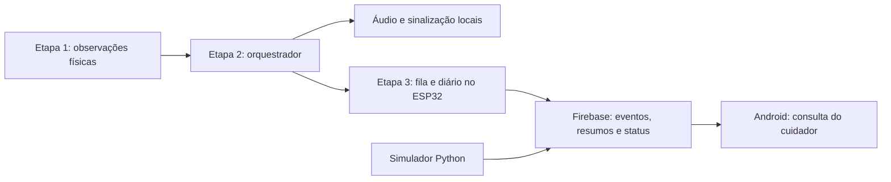

# HIDRA — Documentação técnica de IoT, Firebase e aplicativo

## Organização

A etapa 3 está em [HIDRA_Etapa3](HIDRA_Etapa3/README.md), seguindo a divisão
por etapas utilizada no repositório. Ela inclui o módulo IoT do ESP32, o
Realtime Database, o aplicativo Android e o simulador de comunicação.

As observações `Hidra::EventoFisico` e `Hidra::LeituraHardware` da etapa 1 não
são os eventos remotos `HidraEvent`. O orquestrador converte as observações em
transições da atividade e decide instruções, alertas e encerramento. O módulo
IoT recebe os acontecimentos processados; a nuvem não controla a atuação.

## Componentes

| Componente | Implementação |
|---|---|
| Interface embarcada | `HIDRA_Etapa3/firmware/iot/include/iot.h` |
| Fila, LittleFS, autenticação e HTTPS | `HIDRA_Etapa3/firmware/iot/src/iot.cpp` |
| Cenários e contrato Python | `HIDRA_Etapa3/simulator/` |
| Regras e índices RTDB | `HIDRA_Etapa3/firebase/database.rules.json` |
| Interface Android e repositórios | `HIDRA_Etapa3/android/app/src/main/` |
| Testes e entradas fictícias | `HIDRA_Etapa3/tests/` |

## Persistência e sincronização

`iot_publish` valida e copia o evento para uma fila FreeRTOS de 32 posições.
O retorno positivo indica aceitação em RAM. A tarefa de comunicação mantém
até 200 registros pendentes no LittleFS, com tamanho e CRC32, e publica os
eventos por HTTPS sem operações de rede na chamada do orquestrador.

O publicador consulta o identificador estável do evento com ETag. Um caminho
vazio é criado com PUT condicional e timestamp do servidor; um payload idêntico
já existente confirma um envio anterior. A pendência só avança após atualizar
o resumo cumulativo, sem reincrementar contagens em reenvios. Há uma janela de
perda entre aceitação em RAM e persistência; compilar o firmware não comprova
sua recuperação em corte de energia.

O diário do simulador utiliza SQLite e checksum SHA-256. Ele exercita o mesmo
contrato de comunicação, mas não substitui a validação do LittleFS na placa.
O firmware publica presença a cada 30 segundos quando há comunicação; o
simulador publica status apenas ao terminar o cenário. No aplicativo, 90
segundos sem presença recebida indicam comunicação desatualizada.

## Autorização e aplicativo

O Firebase Authentication identifica dispositivos e cuidadores. As regras RTDB
negam acesso na raiz, autorizam o cuidador por vínculo e restringem a escrita
ao dispositivo dono. Eventos não podem ser editados nem excluídos por clientes.
Metadados e vínculos são provisionados administrativamente.

O Android usa Kotlin, Compose e MVVM. `HidraRepository` separa as consultas da
apresentação; `FakeHidraRepository` atende ao modo demo e
`FirebaseHidraRepository` aos modos de emulador e nuvem. O cuidador consulta
estado atual, histórico e detalhes, sem resolver alertas ou enviar comandos.

As configurações reais ficam em `secrets.h` e `firebase.local.properties`,
ignorados pelo Git. O pacote inclui apenas exemplos públicos. Um projeto real
precisa de contas técnicas, contas de cuidadores e vínculos autorizados.

## Compatibilidade e referências internas

A etapa 1 usa Arduino IDE com core ESP32 3.3.12 ou compatível. A etapa 3 mantém
seu ambiente PlatformIO separado, com Arduino ESP32 2.0.17. Não há um firmware
unificado nesta branch. A interface local do hardware permanece em
`HIDRA_Etapa1/HidraHardware.h`.

- [Preparação, execução, compilação e testes](HIDRA_Etapa3/README.md).
- [Esquema dos eventos e caminhos do banco](HIDRA_Etapa3/docs/CONTRATO.md).
- [Interface C++ e responsabilidades de integração](HIDRA_Etapa3/docs/INTEGRACAO.md).
- [Configuração gratuita no Firebase Spark](HIDRA_Etapa3/docs/FIREBASE_SPARK.md).
- [Resultados e limites da validação](HIDRA_Etapa3/docs/VALIDACAO.md).
