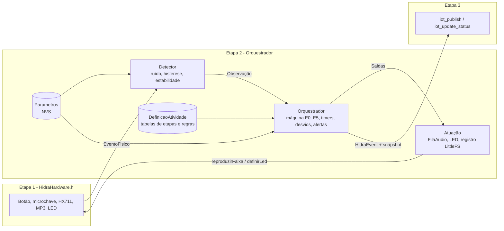
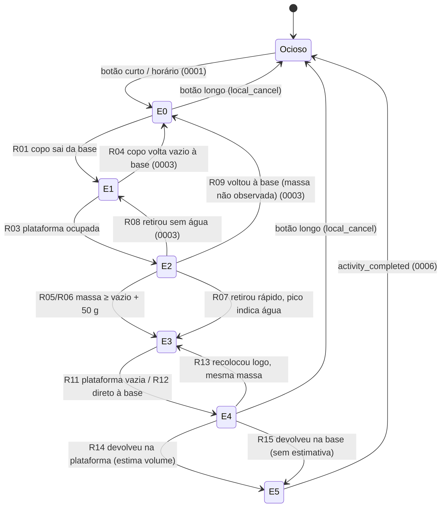

# HIDRA — Documentação Técnica da Etapa 2: Orquestrador de Eventos e Controle Local

**Projeto:** HIDRA — Hidratação Inteligente por Detecção e Resposta Automatizada
**Disciplina:** PCS3930 — Projeto de Extensão III — Escola Politécnica da USP
**Responsável pela etapa:** Enzo Costa Bizinoto
**Plataforma:** ESP32 DevKit (ESP-32D) — Arduino IDE, core Espressif 3.3.x
**Escopo:** máquina de estados E0–E5, orquestrador com temporizadores e desvios, instruções verbais, sinalização e alertas locais, configuração pelo cuidador, registro de eventos e interface com o módulo IoT (Etapa 3).

---

## 1. Resumo do que foi entregue

| Entregável da apostila (Etapa 2) | Onde está | Situação |
|---|---|---|
| Máquina de estados implementada e funcional | `src/orquestrador/Orquestrador.*`, `DefinicaoAtividade.*` | Implementada e testada em simulação |
| Orquestrador com tratamento de temporizadores e desvios | `Orquestrador::tick()`, regras R02/R04/R08/R09/R13 | Implementado e testado em simulação |
| Sistema de reprodução de instruções verbais | `src/plataforma/AtuadoresHidra.*` (`FilaAudio`) | Implementado; usa `Hidra::reproduzirFaixa()` |
| Sistema de sinalização e alertas locais | `LedHidra`, alertas `caregiver_alert` + áudio `0008` | Implementado |
| Interface de comunicação com o módulo IoT | `src/contrato/HidraEvent.*`, `src/iot/HidraIot.h` (stub ou adapter real) | Implementada conforme o contrato da Etapa 3 |
| Documentação das regras de decisão e das transições | este documento | Concluída |

Além dos entregáveis, a etapa implementa requisitos que dependiam do orquestrador: início por horário, configuração pelo cuidador, registro local com data/hora, persistência e recuperação após queda de energia.

**Situação de validação:** toda a lógica foi testada no computador com o **mesmo código** do firmware (73 verificações em 14 cenários + teste de fumaça do firmware completo com simulação de reinício). **Ainda falta** compilar na Arduino IDE e executar os cenários na bancada com o hardware da Etapa 1 (seção 15).

---

## 2. Arquitetura

A divisão segue o "Projeto de solução" da apostila: **Aquisição → Orquestração → Atuação**.



Princípios adotados:

- **A Etapa 1 não foi alterada.** `Config.h`, `HidraHardware.h` e `HidraHardware.cpp` foram copiados byte a byte para `HIDRA_Etapa2/src/hardware/`.
- **Núcleo em C++ puro.** `Detector`, `Orquestrador`, `DefinicaoAtividade`, `Parametros` e o contrato de eventos não incluem `Arduino.h`. Toda ação sai pela interface `Saidas`, o que permite testar a lógica no computador.
- **Nada bloqueia o loop.** O callback da Etapa 1 só copia o evento para um buffer; o áudio usa fila; a rede fica no módulo IoT (`iot_publish` retorna imediatamente).
- **Controle 100% local.** A atividade continua sem Internet; a nuvem só recebe registros (como pede a Etapa 3).

### 2.1. Organização dos arquivos

```text
HIDRA_Etapa2/
├── HIDRA_Etapa2.ino            # setup()/loop(): liga as camadas
└── src/
    ├── hardware/               # Etapa 1 (cópia idêntica, NÃO editar aqui)
    ├── contrato/HidraEvent.*   # HidraEvent, EventData, JSON, boot_id (compartilhado c/ Etapa 3)
    ├── iot/HidraIot.h          # iot_begin / iot_publish / iot_get_status (+ iot_update_status)
    ├── iot/HidraIotStub.cpp    # stub: imprime JSON no modo Arduino IDE
    ├── orquestrador/
    │   ├── Parametros.*        # parâmetros do cuidador + validação
    │   ├── Observacoes.h       # observações significativas e estado físico
    │   ├── Detector.*          # eventos físicos -> observações
    │   ├── DefinicaoAtividade.*# TABELAS: etapas, regras, faixas, motivos
    │   └── Orquestrador.*      # motor da máquina de estados
    └── plataforma/             # código específico do ESP32
        ├── AtuadoresHidra.*    # FilaAudio (MP3) e LedHidra
        ├── PersistenciaHidra.* # NVS (Preferences) e registro LittleFS
        ├── RelogioAgenda.*     # relógio e início por horário
        ├── SaidasFirmware.*    # implementação de Saidas no ESP32
        └── ConsoleHidra.*      # console serial do cuidador
tests/
├── run_tests.sh                # executa tudo
├── test_orquestrador.cpp       # 14 cenários com simulador físico
├── smoke_firmware.cpp          # firmware completo com mocks
└── mocks/                      # Arduino/Preferences/LittleFS/HX711 simulados
```

---

## 3. Como compilar e gravar

1. Abrir `HIDRA_Etapa2/HIDRA_Etapa2.ino` na Arduino IDE (a pasta `src/` é compilada automaticamente).
2. Placa **ESP32 Dev Module**, core Espressif 3.3.x; biblioteca **HX711 (bogde)**.
3. **Tools → Partition Scheme → "Default 4MB with spiffs"** (o registro usa LittleFS nessa partição; na primeira execução ela é formatada automaticamente).
4. Cartão microSD com `/mp3/0001.mp3 … 0008.mp3` (igual à Etapa 1).
5. Ligar com a **plataforma vazia** (tara automática) e o **copo na base**.
6. Monitor Serial a **115200 baud**, final de linha **Nova linha**. Digitar `h` para ver os comandos.

> **Segurança elétrica (pendência da Etapa 1):** o orquestrador **não lê** nada do TX do módulo MP3 (GPIO 25). Enquanto o nível lógico de 5 V não for verificado, o fio TX do MP3 → GPIO 25 pode ser **desconectado** sem prejuízo ao funcionamento.

---

## 4. Interpretação dos sensores (Detector)

O Detector transforma os eventos físicos da Etapa 1 em **observações significativas**, tratando ruído (RNF_TRATAMENTO_RUIDO).

| Observação | Regra de detecção (valores padrão) |
|---|---|
| `CopoSaiuDaBase` / `CopoVoltouABase` | microchave estável por **300 ms** (filtra esbarrões); `chave=1` significa "acionada = copo na base" |
| `PlataformaOcupada(m)` | massa **estável** ≥ **20 g** |
| `PlataformaVazia` | massa ≤ **10 g** por **400 ms** (histerese 10/20 g) |
| `MassaEstavel(m)` | com a plataforma ocupada, nova média estável que difere ≥ **10 g** da anterior |
| `MassaEmMovimento` | variação acumulada ≥ **5 g** desde a última referência estável (usuário agindo) |
| `BotaoCurto` / `BotaoLongo` | soltou antes de 3 s / mantido por **3 s** |
| `SensorMassaIndisponivel` / `Recuperado` | eventos `MassaIndisponivel` / primeira `MassaAtualizada` depois |

**Massa estável:** amostras dos últimos **600 ms** (≥ 3 amostras) com variação ≤ **6 g**; o valor é a média da janela.

**Latências de detecção medidas no simulador** (com o filtro α = 0,35 a cada 200 ms da Etapa 1):

| Transição | Latência após a ação física |
|---|---|
| E1 (copo sai da base) | ~0,3 s |
| E2 (copo colocado na plataforma) | ~2,0 s |
| E3 (água adicionada) | ~1,2 s após o fim do despejo |
| E4 (copo retirado) | ~2,0 s |

A maior parte desse tempo vem do filtro exponencial da Etapa 1 (≈ 1,4 s para chegar a 95% do valor). Se for preciso reduzir, a alternativa mais simples é aumentar `FILTRO_MASSA_ALPHA` (ex.: 0,5) em `Config.h`, em acordo com o responsável pela Etapa 1.

**Tara suspeita:** se a massa estável ficar abaixo de −20 g (tara feita com o copo na plataforma), o LED entra em padrão de falha e o registro avisa para executar `t` com a plataforma vazia.

---

## 5. Máquina de estados

### 5.1. Semântica dos estados

O campo `state` dos eventos indica **a última etapa observada**. A instrução de cada estado orienta **a próxima ação**.

| Estado | Significado | Aguardando | Instrução em caso de demora | Motivo do alerta |
|---|---|---|---|---|
| E0 | atividade iniciada (botão ou horário) | pegar o copo | `0002` "Pegue o copo…" | `no_start` (não iniciação) |
| E1 | copo retirado da base | colocar na plataforma | `0003` "Coloque o copo na plataforma…" | `stalled` |
| E2 | copo na plataforma (massa vazia registrada) | adicionar água | `0004` "Agora, coloque água no copo." | `stalled` |
| E3 | água adicionada (massa cheia registrada) | retirar o copo | `0005` "Muito bem! Agora retire o copo." | `stalled` |
| E4 | copo cheio retirado (bebendo) | devolver o copo | `0007` "Vamos continuar? Ainda falta uma etapa." | `cup_not_returned` |
| E5 | sequência observável concluída | — | entrada: `0006` "Parabéns!" | — |

Áudios de entrada: `0001` ao iniciar (E0) e `0006` ao concluir (E5). Nas demais etapas o sistema **só fala quando há demora ou desvio** (instrução mínima, como no COACH), o que reduz a intrusividade e estimula a autonomia.

### 5.2. Diagrama de transições



### 5.3. Tabela completa de regras (`DefinicaoAtividade.cpp`)

A primeira regra que casar (estado + observação + guarda) é aplicada. "Reproc." reaplica a mesma observação no novo estado (permite encadear transições).

| Regra | Origem | Observação | Guarda | Destino | Tipo | Ação de registro | Instrução |
|---|---|---|---|---|---|---|---|
| R01 | E0 | CopoSaiuDaBase | — | E1 | avanço | — | — |
| R02 | E0 | PlataformaOcupada | copo na base | E0 | **desvio** | — | 0002 |
| R03 | E1 | PlataformaOcupada | — | E2 | avanço (reproc.) | grava massa vazio | — |
| R04 | E1 | CopoVoltouABase | — | E0 | **correção** | — | 0003 |
| R05 | E2 | PlataformaOcupada | água suficiente | E3 | avanço | grava massa cheio | — |
| R06 | E2 | MassaEstavel | água suficiente | E3 | avanço | grava massa cheio | — |
| R07 | E2 | PlataformaVazia | pico indica água | E3 | avanço (reproc.) | massa cheio = pico | — |
| R08 | E2 | PlataformaVazia | — | E1 | **correção** | — | 0003 |
| R09 | E2 | CopoVoltouABase | — | E0 | **correção** | — | 0003 |
| R10 | E3 | MassaEstavel | — | E3 | atualização | atualiza cheio se maior | — |
| R11 | E3 | PlataformaVazia | — | E4 | avanço | marca retirada | — |
| R12 | E3 | CopoVoltouABase | — | E4 | avanço (reproc.) | marca retirada | — |
| R13 | E4 | PlataformaOcupada | voltou < 5 s e ≈ mesma massa | E3 | correção | grava massa cheio | — |
| R14 | E4 | PlataformaOcupada | — | E5 | avanço | **estima ingestão** | 0006 |
| R15 | E4 | CopoVoltouABase | — | E5 | avanço | — | 0006 |

Guardas: *água suficiente* = massa ≥ massa do copo vazio + `agua` (50 g); *pico indica água* = maior massa vista em E2 ≥ vazio + 50 g; *copo na base* = microchave.

Efeitos dos tipos de regra:

- **Avanço:** `state_changed`, zera as tentativas, resolve alertas de falta de progresso (`alert_resolved`, reason `progress`).
- **Correção:** `state_changed` para refletir o mundo físico; se houver instrução, ela é tocada, conta como 1ª tentativa e **conta um desvio**.
- **Desvio:** sem mudança de estado; toca a instrução e conta um desvio.
- **Atualização:** só atualiza dados internos (sem evento).

O exemplo de desvio citado em RF_DETECTAR_DESVIO ("retorno do copo vazio à posição inicial antes do enchimento") é a regra **R04**.

### 5.4. Sincronização no início

O arranjo esperado é copo na base e plataforma vazia. Se, ao iniciar, o copo já estiver fora da base, aplica-se R01 imediatamente; se já houver massa estável na plataforma, aplica-se `PlataformaOcupada` (pode levar direto a E2). Assim o sistema não fica "travado" esperando um evento que já aconteceu.

### 5.5. Estimativa de ingestão (RF_DETECTAR_INGESTAO)

**Fluxo definido pelo grupo:** a microchave serve só para indicar se o copo saiu da posição inicial (E0 → E1, e o desvio R04). O enchimento é feito **em cima da balança** (a massa cresce aos poucos em E2 → E3) e, depois de beber, a pessoa **devolve o copo na balança**. Nas etapas E2–E4 e em RF_DETECTAR_INGESTAO, "base" na apostila significa a balança.

`estimated_intake_ml = massa do copo cheio − massa do copo ao voltar à balança` (1 g de água ≈ 1 ml), regra R14, que é o caminho normal de conclusão. As regras R09, R12 e R15 (copo levado à microchave depois de sair dela) são apenas **contingência**, por exemplo com a célula de carga falhando; R15 conclui a sessão **sem** estimativa. O app deve mostrar "Volume estimado pela variação de massa", e não "ingestão confirmada".

No simulador: copo de 200 g + 250 g de água, devolvido com 300 g → **149 ml** estimados (o copo cheio é medido pelo valor filtrado).

---

## 6. Temporizadores, repetição e alertas

Para cada estado E0–E4, com padrão de 3 tentativas:

```text
última ação ──[timeout da etapa]──> instrução (tentativa 1)
            ──[repetição 30 s]────> instrução (tentativa 2)
            ──[repetição 30 s]────> instrução (tentativa 3)
            ──[repetição 30 s]────> caregiver_alert + 0008 + LED de alerta
```

- **Não iniciação (RF_DETECTAR_NAO_INICIACAO):** o timeout de E0 conta a partir do início do ciclo.
- **Estagnação:** timeouts de E1–E4 contam a partir da entrada na etapa **ou do último sinal de ação** (`MassaEmMovimento`/`MassaEstavel`). Assim, quem está despejando água devagar **não** ouve "coloque água no copo" (testado).
- **Repetição (RF_REPETIR_INSTRUCAO):** a cada `repeticao` sem mudança de estado.
- **Alerta (RF_ALERTAR_CUIDADOR):** após `tentativas` instruções sem progresso. Durante o alerta, o sistema **para de insistir** com o idoso (RNF_NAO_INTRUSIVIDADE) e o LED pisca rápido.
- **Desvios repetidos:** ao atingir `desvios` (padrão 3) na sessão → alerta `deviation`.
- **Sensor de massa indisponível:** após 5 s → alerta `sensor_unavailable` **sem áudio** (a falha não é do usuário); lembretes de etapas que dependem da massa ficam suspensos. Recuperação → `alert_resolved` (`sensor_recovered`).

Valores padrão (uso real) e do modo `demo`:

| Parâmetro | Padrão | `demo` |
|---|---|---|
| E0 (não iniciação) | 60 s | 15 s |
| E1 / E2 / E3 | 45 / 60 / 45 s | 15 s |
| E4 (tempo para beber e devolver) | 300 s | 30 s |
| Repetição | 30 s | 12 s |
| Tentativas antes do alerta | 3 | 3 |

Resolução de alertas: progresso (`progress`), botão do dispositivo (`caregiver_ack`), sensor recuperado (`sensor_recovered`) ou fim da sessão (`session_closed`). Conforme a apostila, abrir o app **não** resolve alertas.

---

## 7. Instruções verbais (RF_REPRODUZIR_AUDIO)

`FilaAudio` envia `Hidra::reproduzirFaixa()` sem bloquear o loop:

- Como o comando "tocar" do MP3 interrompe a faixa em andamento e a Etapa 1 não informa o término, existe um **intervalo mínimo de 2,5 s** entre comandos. Se outra instrução chegar nesse intervalo, toca-se a **mais recente**.
- O volume configurado é reenviado 2,5 s após o boot (o módulo pode ignorar o primeiro comando, como alerta a Etapa 1). Padrão: **30**, o valor validado na montagem atual.
- Cada envio imprime `AUDIO: faixa 000N.mp3 enviada (latencia X ms)`; o comando `s` mostra a última e a maior latência.

**RNF_LATENCIA (< 2 s):** no simulador, a decisão (detecção ou estouro de timeout) → envio do comando leva **≤ 10 ms**. O pior caso é quando outra mensagem foi enviada há menos de 2,5 s (a nova espera o intervalo). O tempo de início do áudio no módulo MP3 precisa ser medido em bancada.

---

## 8. Botão e LED

**Botão (GPIO 18):**

| Situação | Pressão curta | Pressão longa (3 s) |
|---|---|---|
| Sem atividade | inicia a atividade (`trigger: button`) | — |
| Atividade com alerta | cuidador reconhece: `alert_resolved` (`caregiver_ack`) e reinicia o ciclo | cancela (`activity_aborted`, `local_cancel`) |
| Atividade sem alerta | repete a instrução da etapa atual (pedido de ajuda) | cancela |

**LED vermelho (GPIO 23) — RNF_INDICACAO_VISUAL:**

| Padrão | Significado |
|---|---|
| pulso curto a cada 3 s | ligado, sem atividade |
| 1 s aceso / 1 s apagado | atividade em andamento, aguardando etapa |
| piscar rápido (150 ms) | **alerta**: cuidador deve verificar |
| piscada dupla a cada 2 s | célula de carga indisponível ou tara suspeita |
| aceso por 3 s | atividade concluída |

---

## 9. Início por horário (RF_INICIAR_ATIVIDADE)

O ESP32 não tem RTC com bateria. O relógio fica válido quando:

1. o módulo IoT (Etapa 3, `time_service`) sincronizar por NTP — usa o relógio do sistema, nada muda aqui; **ou**
2. o cuidador acertar a hora no console: `relogio 2026-11-14 19:30`.

Até 6 horários diários (`horarios 08:00 10:30 15:00`), disparados uma vez por dia cada. Se já houver atividade em andamento, o horário é ignorado e registrado. Sem relógio válido, o início por horário fica desabilitado (o botão continua funcionando). Fuso padrão: −180 min (São Paulo).

---

## 10. Configuração pelo cuidador (RF_CONFIGURAR_PARAMETROS)

Pelo console serial. Os valores são validados e **salvos na NVS** (sobrevivem a desligamentos). `set`, `demo`, `padrao`, `t`, `copo` e `p1..p8` só são aceitos sem atividade em andamento.

| Comando | Função |
|---|---|
| `s` | estado completo (hardware, interpretação, orquestrador, LED, áudio, IoT) |
| `cfg` | mostra a configuração |
| `set e0..e4 <s>` | timeout de cada etapa |
| `set repeticao <s>` / `set tentativas <n>` / `set desvios <n>` | ciclo de instruções e alerta |
| `set volume <0..30>` | volume do MP3 |
| `set agua/ocupada/vazia/tol <g>` | limiares de massa |
| `copo` | pesa o copo vazio na plataforma e guarda (`massa_copo_g`) |
| `set chave 1/0` | 1 = microchave acionada significa copo na base |
| `set fuso <min>` / `relogio …` / `horarios …` | agenda |
| `demo` / `padrao` | tempos curtos para apresentação / tempos reais |
| `iniciar` / `cancelar` | equivalente ao botão |
| `log` / `log limpar` | registro de eventos |
| `t` / `p1..p8` | tara e teste de áudio (manutenção) |

**RF_PERSONALIZAR_AUDIOS:** basta substituir os arquivos `/mp3/000N.mp3` no cartão, mantendo o conteúdo correspondente à tabela da seção 5.1 (por exemplo, gravações com a voz de um familiar).

---

## 11. Registro e persistência

**Registro de eventos (RF_REGISTRAR_EVENTOS):** cada evento e cada decisão local vão para `/hidra_log.csv` no LittleFS (≈ 48 KB + arquivo anterior, rotativo) e para o Serial. Consulta com `log`. Formato (exemplo ilustrativo):

```text
data_hora_local;boot_id;uptime_ms;session_id;sequence;tipo;estado;dados
2026-11-14 09:00:00;0001;12455;0001_s001;1;activity_started;E0;{"trigger":"schedule","session_order":1}
2026-11-14 09:00:00;0001;12455;0001_s001;2;instruction_played;E0;{"instruction_id":"start","attempt":1}
2026-11-14 09:00:01;0001;13255;-;-;local;-;R01 E0->E1: copo retirado da base (CopoSaiuDaBase, 0.0 g)
2026-11-14 09:00:01;0001;13255;0001_s001;3;state_changed;E1;{"previous_state":"E0"}
...
2026-11-14 09:00:25;0001;37400;0001_s001;9;activity_completed;E5;{"estimated_intake_ml":149}
```

Sem relógio válido, a coluna de data mostra `sem-relogio` e a ordem fica garantida por `boot_id` + `uptime_ms` + `sequence`.

**Persistência (RNF_PERSISTENCIA), na NVS:**

| Chave | Conteúdo |
|---|---|
| `param` | parâmetros do cuidador (com versão; se inválidos, usa o padrão) |
| `boot` | contador de boots → `boot_id` (4 dígitos hex, não se repete entre reinícios) |
| `ordem` | contador persistente de sessões → `session_order` |
| `sessao` | sessão aberta: `session_id`, última `sequence`, estado e alertas ativos |

**Reinício seguro:** ao ligar, se existir sessão aberta, o orquestrador emite `alert_resolved` para os alertas que estavam ativos e `activity_aborted` (`reason: restart`) com a `sequence` seguinte, **antes** de aceitar nova atividade, e volta ao estado ocioso. É o comportamento pedido em "Ordenação e reinicialização".

---

## 12. Interface com o módulo IoT (Etapa 3)

### 12.1. O que já está compatível com a apostila

- `iot_begin(const IotConfig&)`, `iot_publish(const HidraEvent&)`, `iot_get_status()` com as assinaturas da apostila (`src/iot/HidraIot.h`).
- `HidraEvent` com `schema_version`, `session_id[64]`, `sequence`, `type`, `state`, `data`; `EventData` com os campos previstos **e indicadores de presença** (`has_*`).
- O orquestrador preenche `session_id`, `sequence` (1, 2, 3… por sessão) e `data`; `device_id`, `event_id`, `boot_id` e as marcas de tempo ficam com o módulo IoT.
- `session_id = <boot_id>_s<contador local>` (ex.: `0001_s002`), nova sessão a cada atividade.
- Os 7 tipos de evento e seus campos de dados, incluindo `alert_resolved` e `activity_aborted` (`restart` | `local_cancel`).
- `iot_publish` é chamado fora do callback de hardware, nunca bloqueia a atividade, e o retorno `false` só é contado e registrado.
- O serializador `hidra_event_to_json()` reproduz **exatamente** o JSON de exemplo da apostila (verificado em teste) e recusa eventos > 1024 bytes sem truncar.

No modo Arduino IDE, `HidraIotStub.cpp` imprime cada evento como linha `IOT> {...}`. O ambiente PlatformIO `esp32-integrated`, em `HIDRA_Etapa3/firmware`, define `HIDRA_IOT_STUB=0` e compila esta etapa como biblioteca local. O adapter em `HIDRA_Etapa3/firmware/iot/src/orchestrator_adapter.cpp` conecta a interface ao transporte real, sem copiar o orquestrador. Veja [INTEGRACAO.md](HIDRA_Etapa3/docs/INTEGRACAO.md).

### 12.2. Valores enumerados definidos pela Etapa 2 (para as regras do Firebase e o app)

| Campo | Valores |
|---|---|
| `instruction_id` | `start`, `take_cup`, `place_cup`, `add_water`, `remove_cup`, `return_cup`, `completed`, `ask_help` |
| `reason` em `caregiver_alert` | `no_start`, `stalled`, `cup_not_returned`, `deviation`, `sensor_unavailable` |
| `reason` em `alert_resolved` | `progress`, `caregiver_ack`, `sensor_recovered`, `session_closed` |
| `reason` em `activity_aborted` | `restart`, `local_cancel` |
| `alert_id` | `a1`, `a2`, … (único dentro da sessão) |

### 12.3. Contrato implementado com a etapa 3

1. **Snapshot:** `iot_update_status` copia `HidraStatusSnapshot` sob seção crítica. A presença inclui atividade ativa, sequência, tentativa, quantidade de alertas e disponibilidade/massa; publicação a cada 30 s quando conectado.
2. **Ordem:** `activity_started.data.session_order` é aceito pelas regras e preservado no resumo. O contador NVS é elevado ao maior ordinal recuperado do transporte antes de novas sessões, permitindo a migração do firmware de ensaio.
3. **Boot:** o transporte recebe `hidra_boot_id()` e usa o mesmo valor da sessão. O contador não é mais truncado em 16 bits.
4. **Ocioso:** `status.state` continua E0–E5; `activity_active=false` distingue ausência de atividade. O Android apresenta esse estado.
5. **Recuperação:** o sketch combina a referência NVS com a última sequência persistida no diário para a mesma sessão e executa a recuperação da etapa 2 antes de aceitar outra atividade. Aceitação em RAM ainda não garante persistência.

Os testes nativos da ponte usam o orquestrador real; um cenário também é publicado no emulador com autenticação e regras. O firmware integrado foi compilado com o hardware real. Os ensaios de sensores, áudio e latência permanecem na bancada; consulte [VALIDACAO.md](HIDRA_Etapa3/docs/VALIDACAO.md).

---

## 13. Rastreabilidade dos requisitos

| Requisito | Como foi atendido | Situação |
|---|---|---|
| RF_DETECTAR_ESTADOS | máquina E0–E5 orientada a tabela | ✔ simulação |
| RF_DETECTAR_CONCLUSAO | `state_changed` por etapa + `activity_completed` | ✔ simulação |
| RF_INICIAR_ATIVIDADE | botão curto, comando `iniciar` e agenda diária | ✔ (agenda exige relógio válido) |
| RF_DETECTAR_NAO_INICIACAO | timeout de E0 → `0002` → repetições → alerta `no_start` | ✔ simulação |
| RF_DETECTAR_DESVIO | R02, R04 (exemplo da apostila), R08, R09, R13; alerta após 3 desvios | ✔ simulação |
| RF_DETECTAR_INGESTAO | cheio − retorno (retorno pela plataforma); lembrete `0007` se não devolver | ◐ só estima quando volta à plataforma |
| RF_REPRODUZIR_AUDIO | instrução por timeout/desvio, fila não bloqueante | ✔ |
| RF_REPETIR_INSTRUCAO | repetição a cada `repeticao` sem mudança de estado | ✔ simulação |
| RF_REFORCO_CONCLUSAO | `0006` ao entrar em E5 | ✔ |
| RF_ALERTAR_CUIDADOR | após `tentativas` configuráveis: evento + `0008` + LED | ✔ simulação |
| RF_CONFIGURAR_PARAMETROS | console: horários, tempos, repetições, volume (+ limiares) | ✔ |
| RF_PERSONALIZAR_AUDIOS | substituição dos MP3 no cartão | ✔ (Etapa 1) |
| RF_REGISTRAR_EVENTOS | LittleFS com data/hora + comando `log` | ✔ teste de fumaça |
| RNF_ESTABILIDADE | sem alocação dinâmica, loop não bloqueante, sanitizers nos testes | ◐ falta teste longo em bancada |
| RNF_TRATAMENTO_RUIDO | confirmação 300 ms, janela estável, histerese; teste com ruído | ✔ simulação |
| RNF_PERSISTENCIA | NVS (config/sessão) + LittleFS (registro) + `activity_aborted(restart)` | ✔ teste de fumaça |
| RNF_NAO_INTRUSIVIDADE | fala só quando necessário; para de insistir durante o alerta; sem áudio em falha de sensor | ✔ |
| RNF_INDICACAO_VISUAL | 5 padrões de LED | ✔ |
| RNF_LATENCIA | decisão → comando ≤ 10 ms (simulado); detecção de massa ~2 s pelo filtro | ◐ medir na bancada |
| RNF_EXTENSIBILIDADE | etapas, regras, faixas e motivos em tabelas (`DefinicaoAtividade.cpp`) | ◐ tabelas em código C++, não em arquivo externo |
| RNF_PRIVACIDADE | não captura áudio/imagem; registra só dados da atividade | ✔ |

---

## 14. Testes

```bash
cd tests && ./run_tests.sh      # Linux, macOS ou WSL com g++
```

**`test_orquestrador.cpp`** compila o mesmo código do firmware e simula o mundo físico (célula de carga com o filtro α = 0,35 a cada 200 ms, microchave, botão, ruído gaussiano):

| # | Cenário | Verifica |
|---|---|---|
| 1 | Fluxo normal E0→E5 | trilha, sequence contínua, só `0001` e `0006`, ~150 ml, latências |
| 2 | Não iniciação | `0002` aos 60 s, 2 repetições, alerta `no_start` aos 150 s, silêncio durante o alerta, resolução por progresso |
| 3 | Estagnação + despejo lento | despejo adia o lembrete; lembrete `0005` em E3 |
| 4 | Copo devolvido vazio (exemplo da apostila) | E1→E0 com `0003`; 3 desvios → alerta `deviation` |
| 5 | Retirou sem água / encheu e retirou rápido | correção E2→E1; R07 com pico |
| 6 | Recolocou sem beber / devolveu pela base | E4→E3; conclusão sem estimativa |
| 7 | Botão | reconhecer alerta, repetir instrução, cancelar com alerta resolvido antes |
| 8 | Reinício | `alert_resolved` + `activity_aborted(restart)`, sequence continua, novo boot_id |
| 9 | Sensor indisponível | alerta sem áudio, lembretes suspensos, recuperação |
| 10 | Sincronização inicial | início com copo fora da base e na plataforma |
| 11 | `massa_copo_g` conhecida | copo já chega com água → E3 |
| 12 | Ruído σ = 2 g | 10 min ocioso + 30 s em E2 sem transições espúrias |
| 13 | JSON | igual ao exemplo da apostila; estouro recusado |
| 14 | Ruído σ = 3 g + deriva | não adiam o lembrete indevidamente |

**`smoke_firmware.cpp`** compila o **sketch completo** (`.ino` + Etapa 1 + Etapa 2) com mocks de Arduino, Preferences, LittleFS e HX711 e verifica: boot_id, ajuste de relógio, início às 09:00 pela agenda, sessão completa (149 ml), bytes UART do MP3 (faixas 0001 e 0006), ausência de lembretes desnecessários, registro com data/hora, validação de parâmetros, sessão aberta na NVS e, numa segunda execução, a recuperação após reinício e a persistência da configuração.

Resultado atual: **73/73 verificações e teste de fumaça OK**, sem avisos de compilação, com AddressSanitizer/UBSan.

---

## 15. Pendências e decisões para o grupo

1. **Compilar na Arduino IDE e testar na bancada** (não foi possível compilar com o toolchain do ESP32 neste ambiente). Roteiro sugerido para os cenários de demonstração da semana 6:
   - *Cenário A — normal:* `demo`, botão, pegar, posicionar, encher, retirar, devolver na plataforma → conferir `log`.
   - *Cenário B — não iniciação:* botão e não fazer nada → 3 lembretes e alerta (LED rápido); botão curto para reconhecer.
   - *Cenário C — desvio:* pegar o copo e devolvê-lo à base → "Coloque o copo na plataforma".
   - Medir com cronômetro/vídeo a latência real entre ação e início do áudio (RNF_LATENCIA).
2. **Ajustar os limiares com o copo real** (`copo`, `set ocupada`, `set agua`). Os valores padrão supõem um copo ≥ 20 g e pelo menos 50 ml de água.
3. **Confirmar a montagem da microchave** (acionada = copo na base). Se for o contrário: `set chave 0`.
4. **Mensagem de E4 (opcional).** Confirmado que a pessoa devolve o copo na balança depois de beber. Se ela demorar, o lembrete hoje usa `0007` ("Vamos continuar? Ainda falta uma etapa"). Uma **9ª mensagem** mais específica ("Quando terminar de beber, coloque o copo de volta na plataforma") deixaria a instrução mais clara; isso exige mudar `ULTIMA_FAIXA_MP3` para 9 em `Config.h` (combinar com o Fernando) e trocar `FAIXA_CONTINUAR` por 9 na etapa E4 de `DefinicaoAtividade.cpp`.
5. **Contrato implementado com a Etapa 3** (seção 12.3): `iot_update_status`, `session_order`, `boot_id` compartilhado e estado no modo ocioso.
6. **Apostila:** RNF_EXTENSIBILIDADE fala em "arquivo de configuração"; a implementação usa **tabelas** separadas do motor (`DefinicaoAtividade.cpp`). Vale ajustar o texto ou, no futuro, carregar a tabela de um JSON no LittleFS. O requisito RF_REFORCO_CONCLUSAO tem a descrição copiada de RF_REPETIR_INSTRUCAO na apostila — corrigir para "reproduzir mensagem positiva ao concluir".
7. **Sessão parada em alerta.** Uma sessão em alerta só termina por progresso, cancelamento (botão longo) ou reinício. Não há encerramento automático por tempo, pois o contrato só prevê `restart` e `local_cancel` para `activity_aborted`.
